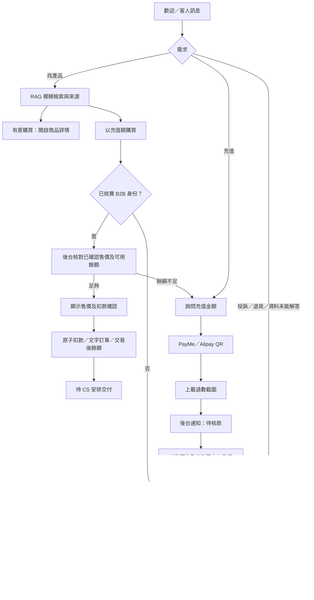

# Naturalia 對話、充值與 CS 流程

更新：2026-11-24。本機可獨立測試；本文件取代較早版本「未有扣款／只有暫停 AI」的描述。

多輪跳題、短答、修改數量及例外情況另見 [多輪對話流程](DIALOGUE_FLOWS.md)。

## 歡迎語

> 你好，歡迎嚟到 Naturalia！🌿 我可以幫你按功效、品牌或預算搵產品，亦可以協助充值同以充值額購物。想先搵產品，定辦理充值？

網站首次打開、測試 Chat 空對話顯示歡迎語；WhatsApp 首次回應亦包含歡迎語。

## 客人流程



## CS 對話頁

入口：`/admin#cs`。參考 Meetbiz 本機 `apps/web/public/images/AI-tutorial/conversations/1.png` 至 `4.png` 的介面與操作方式，沒有沿用其平台服務或程式碼。

- 網站、WhatsApp、測試 Chat 集中顯示，要求人工的對話排前。
- 公司／電話／最後訊息搜尋、渠道及處理狀態篩選。
- 顯示轉人工原因、客人與助手氣泡、人工回覆狀態。
- 人工接手、直接回覆、主動交回 AI。接手期間不呼叫生成模型。
- 網站及測試 Chat 會輪詢收到 CS 回覆；WhatsApp 人工回覆使用該連線帳戶發送。
- WhatsApp 未連線或送出狀態不明時顯示待核對，不會自動重送。
- 後台輪詢提示待核款申請與待處理 CS；目前不是作業系統桌面推播。

## 身份及帳本

SHOPLINE 是 B2C 店面，只作客服與導購接入；本系統 B2B 客戶、充值及訂單獨立運作。

- 網站訪客填寫電話不等於通過身份驗證。CS 須經可信渠道核實擁有人，再於對話頁綁定已有 B2B 客戶。
- WhatsApp 使用經連線傳入的電話 JID 或可信 LID 對應電話，自動與唯一符合的 B2B 客戶配對。香港 8 位電話統一加 852。LID 本身不是電話，有可信電話但未有客戶時，自動建立客戶及零餘額充值戶口；同一電話重用原戶口。無法取得可信電話或電話重複時才交 CS 核實。
- WhatsApp 新客自動開戶；其他客戶可由後台手動新增。未核實身份的網站訪客不能查餘額或扣款。
- 測試 Chat 的帳戶選擇只供已登入管理員／客服使用，模擬身份後操作的是**本機 B2B 帳本**；清空對話不會沖銷交易。

## 充值核款

- QR 使用項目現有 `info/PayMe.jpeg`、`info/alipay.jpeg`，沒有編造收款資料。
- 客人輸入港幣金額（正數、最多兩位小數），即提供 PayMe 及 Alipay 兩張 QR 圖，再回覆付款方式及上載 PNG／JPEG 截圖（最多 5 MB）。不再向客人列出方案。
- 如先傳截圖，暫存憑證並詢問付款方式，收到 PayMe／Alipay 回覆後自動建立待核款申請，毋須重傳。
- 截圖只建立待核款申請，不代表已付款。財務／管理員核實實收，填寫收款平台的真實交易編號後才能批准。
- 相同截圖跨申請會被攔截；相同付款方式與實際交易編號不能重複入帳。人工仍須核對收款平台，不以圖片內容自動確認付款。
- 自訂金額以實收等額本金入帳，贈額為 0，不設到期；舊方案及已提交申請仍沿用原快照條款。核款記錄與通知保留。

## 充值額購買

- `/admin#orders` 可由管理員／財務選擇性調整個別商品售價及啟停，並非購買前置步驟。
- 按用戶確認，預設直接使用商品資料內的港幣售價；商品卡及購買扣款採用同一價格。如設定個別價格則一併覆蓋，停用或無有效價格才轉 CS。價格來源仍是本機目錄，非 SHOPLINE 即時串接。
- 網頁每個商品有「有意購買」及「以充值額購買」。後者查後台餘額，足夠時提供 10 分鐘有效報價及明確確認按鈕。
- 購買數量支援 1 至 99 件。報價及訂單保存單價、數量及總額；確認時再檢查身份、單價、有效餘額、目前報價及對話狀態，扣款及出單在同一資料庫交易完成。
- 同一報價重複確認回傳同一訂單；不重複扣款。並行購買不允許透支。
- 優先扣最早到期額度；相同到期時間先贈額後本金，無到期日額度排後。
- 原充值流水不改動；扣款另有不可修改的分配記錄。客戶頁顯示扣款後剩餘有效額度。
- 回覆提供文字訂單、商品、扣款金額、交易後餘額及「待 CS 安排交付」。沒有宣稱已發貨或已同步 SHOPLINE 訂單。
- 投訴、退貨、退款交 CS 處理；未實作自動退款或物流發貨。

## WhatsApp 差異及驗收界線

- QR 掃碼版逐件提供商品圖片、詳情連結及短指令：`買 A7K9`、`A7K9 2個`、`確認`、`充值` → 輸入金額 → `PayMe`／`Alipay`。商品改為全資料庫唯一且固定的 4 字元短碼，購買上下文限於該對話，舊確認編號仍可辨識但不再作主要提示。商品碼可加語氣字，例如 `RTY6呀`；疑似多打一個英文字會要求確認正確四字碼。商品說明不再附加「充值：回覆充值」。網頁有兩個商品按鈕；WhatsApp 原生互動按鈕尚未實作。
- 回覆付款步驟時發送原始 QR 圖片；接收 JPEG／PNG 圖片作過數截圖。
- AI 暫停時的新訊息仍會同步至 CS；圖片附件可由 CS 查看。
- 目前仍需手機掃碼並實測實際收發，未使用真實 WhatsApp 帳戶進行送訊驗收。
- Kimi K2.6 已有配置，測試 Chat 可手動選用。此次自動驗證使用離線／假模型，不產生付費 API 請求。

## 可重現測試

```sh
chatbot/.venv/bin/python -m unittest discover -s chatbot/tests
node --test chatbot/whatsapp/test/core.test.mjs
```

涵蓋身份隔離、審批及權限、截圖提交、充值入帳、銀行流水去重、報價與扣款去重、並行不透支、過期額度、價格變動、CS 接手／恢復與人工回覆。

另使用隔離資料庫 `.cache/workflow-check/b2b.sqlite3` 與 8768 測試服務跑完整 HTTP 流程。Chrome 已檢查 CS 版面、歡迎語、離線商品檢索及兩個商品入口；測試資料不寫入主要 8765 帳本。


## CS 清除對話

CS 選定客人後，在頂部按「清除對話」，核對名稱及影響範圍後確認。只清該對話的訊息與 AI 上下文，舊商品選項及未確認購買失效；保留客戶、餘額、已提交充值申請、憑證、訂單及人工接手狀態。手機 WhatsApp 訊息和連接頁傳輸紀錄不會刪除。客服／管理員可操作並有稽核紀錄；清除期間發現新訊息或回覆仍在處理則要求重試。


## 憑證預覽及核款結果通知

核款視窗顯示付款圖片，點擊放大，原尺寸／適合畫面切換，並保留下載。批准後主動通知入帳額、核款時餘額及申請編號；拒絕後通知原因及未增加充值額。通知沿原對話回覆，不改人工接手狀態。WhatsApp 斷線則排隊重試，後台顯示待發／已送出／結果待核對；結果不明須 CS 核對手機，不自動重送。手動建立而沒有原對話的申請，需 CS 另行聯絡客戶。

## 拒絕後重新申請及資料保留

金額、付款方式、截圖可按任何次序提供；對話草稿保留三項資料，只詢問缺少的部分，齊全後自動建立一次待核款申請。已傳截圖後不再要求重傳或重新過數。拒絕後的截圖開啟新草稿，不沿用更早未完成付款意圖；原拒絕記錄及證據保留。同一對話、同一客戶可重新提交被拒絕的憑證，並記錄重交稽核；待核款或已批准憑證不能重複申請。人工核實實際流水及交易編號去重維持不變。

「已付款」、「入左了」、「充值了喇」識別為付款進度詢問：已提交則顯示該次核款狀態；未提交則保留資料，提示尚欠金額、付款方式或截圖。不憑文字聲稱自動入帳，亦不重發付款 QR。草稿仍按對話隔離、24 小時失效；「取消充值」或「重新申請」會清除未提交草稿並停用舊付款意圖。

## 購買上下文及多件數量

每段對話保存當前商品、數量及待確認報價。「確認」、「確認購買」、「OK」、「好呀」等肯定回覆只確認目前有效報價；「確認？」等問句不扣款。取消、人工接手、重新搜尋、更換商品、改數量及清空對話會令舊確認失效或要求重新報價。重複確認已完成的同一報價返回原訂單，不再次扣款。過期或改價先展示新報價，必須再確認。

支援「買 2 個」、「改兩件」、「我要兩個」、「JWU3 × 2」及「買 JWU3 2個」；數量須為 1 至 99 的整數。多款商品而未選定時先提供商品卡讓客人選擇，不猜測扣款。錯誤確認編號或無法理解的購買指令保留商品卡、圖片及下一步提示，不當作新商品搜尋。舊的「確認購買 2」仍是確認編號，數量須用「買 2 個」或網頁數量欄。

網頁及後台測試 Chat 提供數量欄和「更新數量及報價」；修改欄位即停用舊總額確認按鈕。後台訂單列表及文字訂單顯示數量、單價、總扣款及餘額。舊訂單遷移為數量 1、單價等於原總額，不改原交易金額。

## 指定產品與推薦結果

客人明確講出產品名稱時，先按中英文正式名稱及獨有系列名稱辨識，忽略大小寫、空格及標點；例如「Hi 我想購買 delight 3 Pro專業套裝」只顯示 Delight 3 Pro 一款，保留圖片、價格、詳情及購買碼，不湊足三款。同名但不同貨號的商品先列出貨號供選擇；功效、類型或要求替代品仍走模糊／語意搜尋。

Kimi 選出的商品與實際送出的產品卡使用同一組 ID、同一次序，文字不再只介紹一款而圖片附帶其他未選商品。模型失敗時，已明確指定的產品仍只回傳該款。正在輸入充值金額時亦不會把 Delight 3 Pro 中的「3」當成錯誤金額。

## 預算搜尋與充值分流

「有沒有什麼是1200以下的？」、「1200以內」、「不超過1200」、「預算1200」及「under HK$1,200」優先當作產品預算搜尋，即使之前正辦理充值。以下／以內／不超過包含上限；低於／少於／under 不包含上限。純數字在充值步驟仍是充值金額，「充值1200」也維持充值。

預算以整數分及當前有效售價篩選，包含後台個別售價調整；未有價格及停用產品不推薦。最新明確預算不混用先前對話的金額。送出產品卡前再核對售價，沒有符合結果時說明並詢問是否提高預算或改類型，不回退至超預算商品或充值錯誤。不修改原充值草稿、付款證據、申請或餘額。
