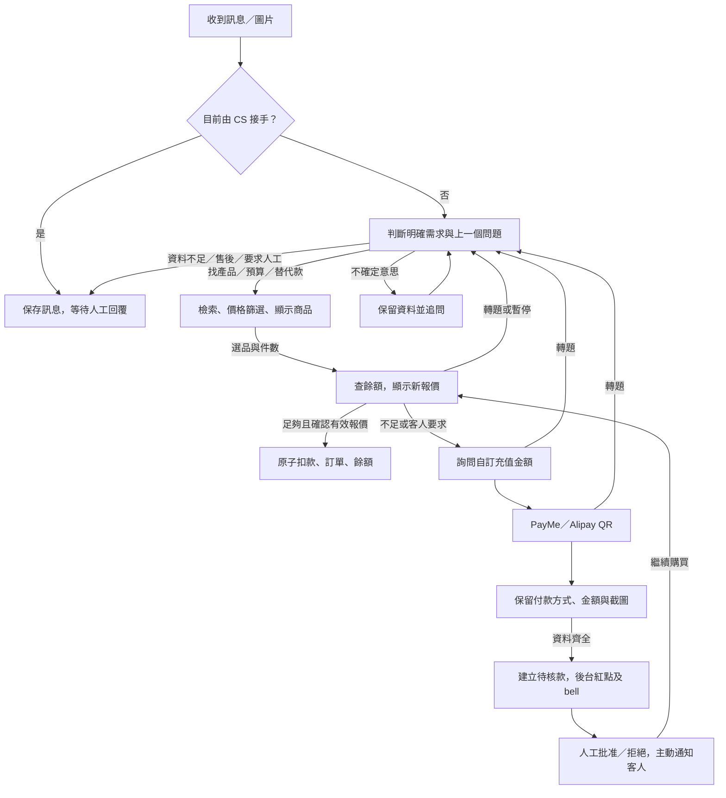

# 多輪對話與跳題流程

更新：2026-11-24。適用於網站、測試 Chat 及 WhatsApp，共用後端分流。

## 原則

每次回覆保存目前話題、上一個問題、實際顯示的商品次序、預算及已看商品。充值草稿與購買選擇另行保留；有草稿不代表之後每句都是充值答案。

明確的新需求先轉題；短答根據上一個問題理解。模型只協助辨認查詢、比較、產品資料及求助意思，不能決定金額、件數、核款、取消或扣款。意思不明先追問；連續未能理解或資料不足時交 CS。

## 主要情況

| 目前情況 | 客人回覆例子 | 處理 |
|---|---|---|
| 新對話 | hi／你好 | 歡迎語，保持 AI 處理 |
| 已有充值草稿 | 有沒有什麼是1200以下的？ | 轉產品搜尋，按後台有效售價篩選，草稿保留 |
| 預算搜尋 | 500 | 更新預算；不當成充值 |
| 多款商品 | 第二款／第二款要兩個 | 按實際顯示次序選品，查餘額並報價 |
| 多款商品 | 買呢個／都要 | 問清楚哪款；逐款確認，不猜測購物籃 |
| 指定名稱 | 維他命原B5植物深層修護髪膜 | 只顯示該產品；同名多貨號則請選擇 |
| 看完商品 | 平啲／其他款 | 保留產品類型與預算，排除已看商品；沒有其他結果則問是否調整條件 |
| 選好商品 | 我想要呢個兩件唔該／加多1個／減少1個 | 重新核對件數、單價、總額、餘額並報價，不扣款 |
| 購買數量不合法 | 買1.5個／買-1個／買100個 | 提示 1–99 整數並保留商品；舊報價停止使用 |
| 當前有效報價 | 確認／OK／好 | 再核對價格、數量、有效期、身份及餘額，原子扣款出單 |
| 確認後重送 | 確認／相同事件重試 | 返回原訂單，不重複扣款 |
| 待購買時轉題 | 餘額／充值／等陣先／產品搜尋 | 暫停原確認；返回購買須重新顯示有效報價 |
| 意思不明 | 幫我處理埋啦 | 追問具體操作；之後答「好」不會沿用舊報價扣款 |
| 充值問金額 | 500／改為700 | 保存自訂充值額，詢問 PayMe／Alipay |
| 充值問方式 | 我想用Alipay／改用PayMe | 保存或修改方式，顯示對應 QR |
| 充值途中 | 好／確認／明白 | 提示目前缺少資料；不確認購買、不入帳 |
| 未付／已付 | 點樣充值／已付款 | 提供步驟或要求付款截圖；打字說已付款不等於入帳 |
| 收到圖片 | 無說明的圖片 | 非充值話題先確認是產品圖還是過數截圖；已保存圖片不用重傳 |
| 充值中收到產品圖 | 呢個產品幾錢 + 圖片 | 不當作付款憑證；交 CS 查核圖片內容 |
| 截圖先到 | 截圖 → 金額 → 方式（任意順序） | 保留資料，齊全後建立一次待核款申請 |
| 有未完成草稿 | 核款進度 | 只讀狀態，不因查詢而提交保存的截圖 |
| 已提交申請 | 收到未／核款進度／繼續 | 告知待核款／批准／拒絕；不重建同一申請 |
| 拒絕後重申請 | 新截圖／重新申請 | 保留原審核記錄，收齊新申請資料 |
| 核款後 | 確認／繼續購買 | 一般確認不直接購買；明確繼續購買才重新報價 |
| 未完成操作 | 取消 | 取消目前未提交的充值或未完成購買；不取消另一流程的記錄 |
| 已提交／已完成 | 取消訂單／退款／投訴 | CS 接手，不自動退款或撤銷已核款交易 |
| 未有確認資料 | 充值手續費／有效期等 | CS 跟進，不編造政策或當成錯誤金額 |
| 人工接手中 | 任何新訊息 | 保存到 CS 工作台；AI 不自行恢復 |

## 流程圖



## 實作與驗證

`chatbot/dialogue.py` 負責目前話題及短答分流；`purchase_flow.py` 與 `commerce.py` 負責交易驗證。對話狀態保存在回覆 payload，重啟仍可恢復；舊對話按既有商品、報價及充值回覆推導狀態，不重播交易。

`kimi.interpret` 只接受白名單意圖，不接受交易執行指令。服務失敗時回到規則或追問。產品資料繼續經 RAG 引文核對；不保證所有自然說法均能辨識，未能確認時不猜測扣款或資料。

目前 136 項 Python、29 項 Node 測試通過。測試涵蓋流程切換、數量、價格與預算、付款資料順序、附件、人工、重試、跨對話隔離與服務重載。使用臨時資料庫及模型假回應；另以現有資料的隔離副本重播 11 輪 WhatsApp observe → reply，確認財務表與餘額不變。沒有呼叫付費模型或向真實 WhatsApp 發送測試訊息。

```sh
chatbot/.venv/bin/python -m unittest discover -s chatbot/tests -q
cd chatbot/whatsapp && npm test
```
