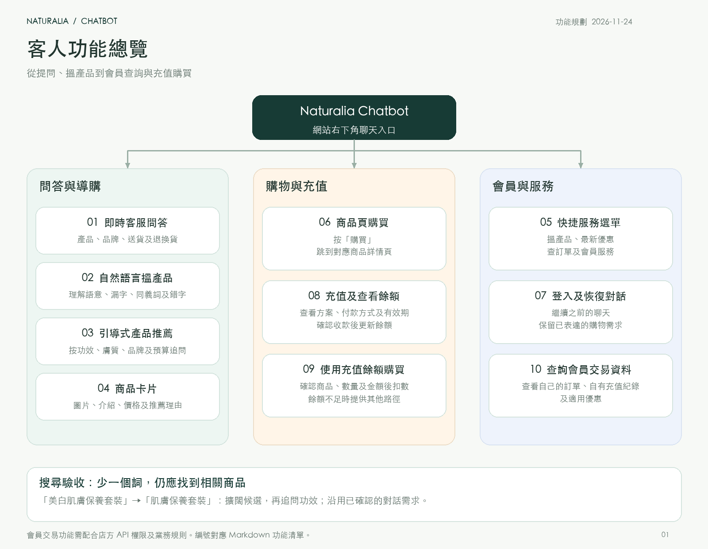
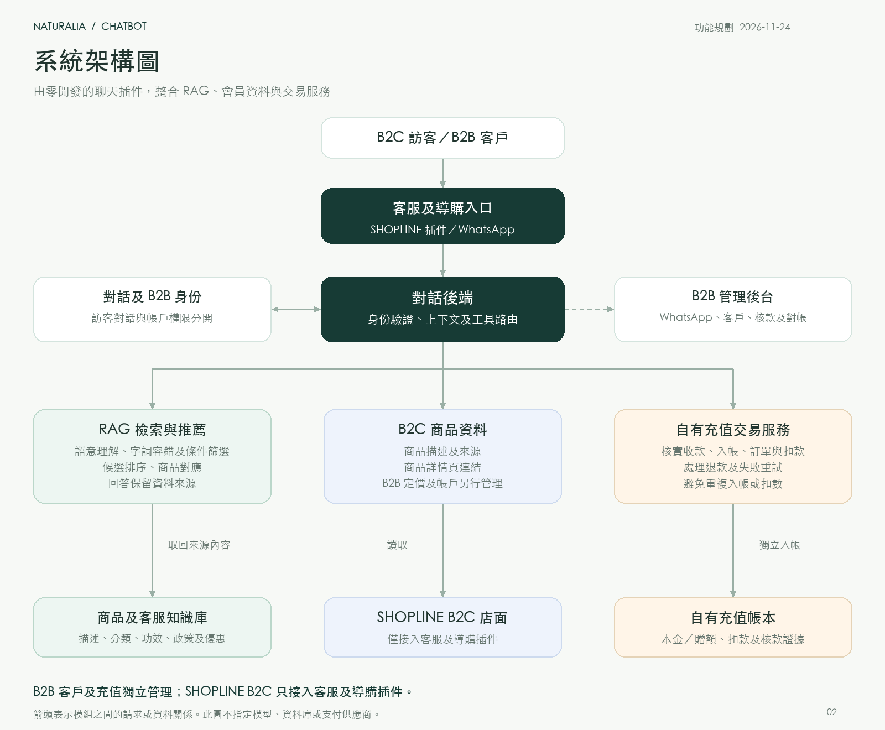

> 2026-11-24 更新：已加入 CS 對話工作台、QR 截圖核款、餘額購買及文字訂單。最新流程與驗收界線見 [CHAT_WORKFLOW.md](CHAT_WORKFLOW.md)；較早「未實作扣款／只有暫停 AI」記錄已被本次更新取代。

# Naturalia Chatbot 功能規劃

更新日期：2026-11-24（香港時間）

由零開發嵌入 Naturalia 網站的客服及導購 Chatbot，採用 RAG，支援語意及模糊搜尋。以下為整體開發規劃；獨立測試版已實作，進度及驗收限制見 [實作紀錄](IMPLEMENTATION_STATUS.md)。SHOPLINE 是 B2C，僅接入客服及導購插件；我們是獨立 B2B。自有充值帳本獨立於 SHOPLINE；先建立管理後台，詳見 [後台實作計劃](ADMIN_PLAN.md)。SHOPLINE 串接另需店方授權。

不使用 Meetbiz Staff AI Agent，也不以 sample 網站的程式碼為基礎。現有截圖只保留作介面及互動參考。

**客人角度的功能清單**

1. **即時對話及客服問答**：從網站右下角打開聊天視窗，詢問產品、品牌、送貨、退換貨及會員服務。
2. **自然語言搵產品**：使用廣東話、中文或英文描述需要；漏字、同義詞及輕微錯字，也應找到相關商品。
3. **引導式產品推薦**：按功效、膚質、品牌及預算提供相關選擇；資料不足時提供選項或追問。
4. **商品卡片**：在對話中查看圖片、名稱、簡介、價格及有資料支持的推薦理由。
5. **快捷服務選單**：點選「搵產品」「最新優惠」「查訂單」「會員服務」等選項，開始相關對話。
6. **前往商品頁購買**：按「購買」，跳到 Naturalia 的對應商品詳情頁。
7. **會員登入及恢復對話**：登入後繼續之前的聊天，保留已表達的購物需求。
8. **充值及查看餘額**：查看充值方案、付款方式、可用取貨額及有效期；確認收款後更新餘額。
9. **使用充值餘額購買**：按「充值購買」，確認商品、數量及金額後，使用可用餘額付款；餘額不足時提供充值或其他購買路徑。
10. **查詢會員交易資料**：查看自己的訂單、自有充值額使用紀錄及適用優惠。

[SVG 圖](01-customer-functions.svg) · [Mermaid 原始檔](01-customer-functions.mmd)

**程序員角度的功能清單**

1. **獨立聊天插件**：自行開發前端及後端，以嵌入方式接入網站，支援手機及電腦。
2. **對話管理**：處理訪客與會員身份、對話儲存、歷史載入及上下文延續。
3. **RAG 知識庫**：整理商品、品牌、客服政策及優惠，建立可追溯來源的檢索內容；保留商品 ID、SKU、來源及詳情頁連結。
4. **語意及模糊搜尋**：支援同義詞、漏詞、口語及錯字；同時尊重品牌、預算、商品形式及排除條件。具體檢索服務和資料庫選型尚未定案。
5. **搜尋排序及推薦**：按需求相關程度排序，把候選結果對應到真實商品，產生商品卡片及有依據的推薦理由。
6. **SHOPLINE API 串接**：商品來源及導購連結可對應 SHOPLINE；不把其會員、訂單或購物金接成 B2B 業務流程。
7. **會員認證及資料權限**：驗證登入身份，確保客人只可讀取自己的對話、訂單及餘額；商戶憑證放在後端。
8. **充值及購買交易流程**：建立獨立充值帳本，處理收款確認、本金／贈額批次、有效期、預留、扣數、退款及重試。
9. **資料更新及營運管理**：更新商品知識、客服內容及優惠有效期。已確認先規劃管理後台，包括核款、帳本、客戶、對話及內容維護。
10. **搜尋驗收及運作監察**：測試完整句、漏字、同義詞、錯字及多輪對話；記錄查無結果、API 失敗及交易異常，方便改善。

[SVG 圖](02-system-architecture.svg) · [Mermaid 原始檔](02-system-architecture.mmd)

**RAG 搜尋驗收要求**

少了「美白」，應擴闊相關候選範圍，不能直接變成查無商品，也不能自行認定客人仍想美白。若前文已確認美白需求，後續省略該詞則應保留對話上下文。

| 客人輸入或情境 | 預期行為 |
| --- | --- |
| 「我想找美白肌膚保養套裝」 | 優先找出有來源支持美白需求的護膚套裝 |
| 「我想找肌膚保養套裝」 | 找出相關護膚套裝，美白套裝可在候選中；需要時再問功效 |
| 「想搵提亮膚色嘅護膚套裝」 | 按語意匹配商品描述，不要求逐字相同 |
| 「我想找美白肌膚保養套莊」 | 容忍輕微錯字，仍找出相關候選 |
| 前文確認想美白，之後問「有冇套裝？」 | 延續已確認的美白需求 |
| 「唔要美白，想搵保濕套裝」 | 尊重排除條件，優先保濕套裝；沒有符合商品時清楚說明 |

驗收時以真實商品 ID 標記預期候選，檢查相關商品有否被檢索到，以及排序是否合理。不得捏造商品、價格或功效。RAG 用來找資料及支援回答，即時餘額、庫存及交易結果由後端查詢和核實。

**交易及串接前需落實的事項**

- 確認 B2C 客服插件的安裝方式；B2B 客戶及帳戶權限由本系統獨立處理。
- 確認收款通知或人工核款流程，完成收款核實後才增加自有充值額。
- 釐清自有充值的手續費及有效期；SHOPLINE 的 180 日購物金規則不套用到本制度。
- 確認目前有效的充值及 VIP 優惠，避免使用過期內容。
- 釐清訂單、扣款、失敗重試及退款的協調流程。

**檔案及來源**

此資料夾包含本文件、兩張 PNG 圖、兩張 SVG 圖及兩份 Mermaid 原始檔。PNG 可直接查看，SVG 可縮放或編輯，Mermaid 可修改節點及關係後重新排版。

- [專案重點紀錄](../../PROJECT_NOTES.md)
- [網站 API 調查及官方文件](../../API_REVIEW.md)
- [早期需求](../../info/chatbot.md)，如有差異以本次確認的重新開發及 RAG 要求為準。
- [商品資料](../../data/naturalia-group/products.json)

