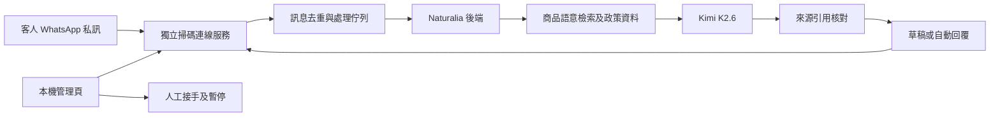

# WhatsApp 通道

2026-11-24：用戶確認使用類似 Meetbiz Staff AI Agent 的掃 QR Code 方式，維持 Naturalia 獨立 Chatbot 及 Kimi K2.6。

本機管理入口：http://127.0.0.1:8767

已實作 QR、連線狀態、草稿、確認送出、自動回覆、對話記錄、人工接手及獨立模擬。實際使用流程及驗收限制見 [WhatsApp 開發說明](../../chatbot/whatsapp/README.md)。

WhatsApp 對話與網站訪客對話分開；不會只憑電話號碼自動合併或取得 SHOPLINE 會員資料。會員綁定仍需要 OAuth 驗證。
